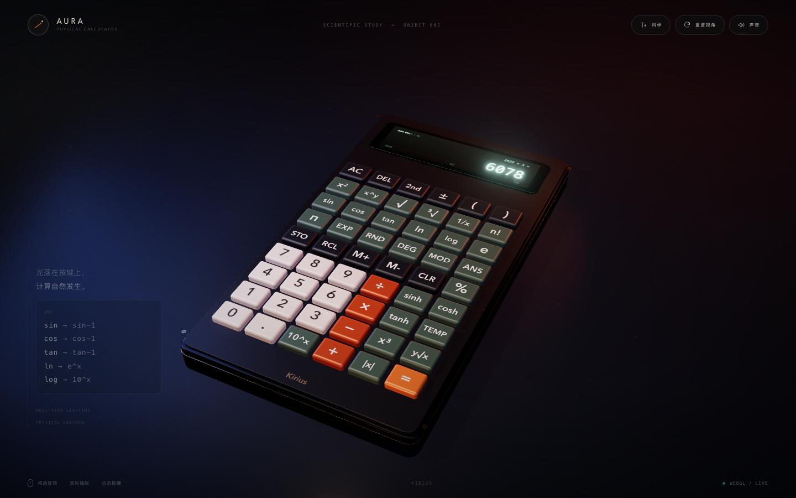

# AURA · 3D 科学计算器

一台放在浏览器里的实体质感桌面科学计算器。使用 Three.js / WebGL2 实时渲染，按键、屏幕、材质与光影都不是图片贴图。

**[在线体验 →](https://kiriusss.github.io/aura-3d-calculator/)**

[](https://kiriusss.github.io/aura-3d-calculator/)

## 特性

- **实体建模**：圆角金属机身、哑光面板、象牙白数字键、琥珀色运算符与鼠尾草绿函数键，底部刻有 Kirius 铭牌。
- **真实光影**：HDR 工作室环境、PBR 材质、ACES 色调映射、软阴影、接触阴影、泛光与实时屏幕自发光。
- **可触摸的按键**：54 个独立 3D 键帽，支持悬停微亮、按下回弹、程序化机械按键音，以及设备支持时的触感反馈。
- **科学运算**：幂与根（x²、x³、x^y、√、³√、y√x、1/x、|x|）、三角与反三角、双曲函数、ln / log / e^x / 10^x、阶乘、nCr、π、e、取模、科学计数法、括号与优先级。
- **精确小数**：加减乘除使用大整数十进制运算，0.1 + 0.2 得到 0.3 而不是 0.30000000000000004。
- **记忆与角度**：STO / RCL / M+ / M− / CLR / ANS，DEG / RAD / GRAD 可切换。
- **2nd 第二功能**：sin → sin-1、cos → cos-1、tan → tan-1、ln → e^x、log → 10^x、n! → nCr，键帽标签实时切换。
- **双机身**：科学模式与基础模式可一键切换，两台实体机身会沉入地面再升起完成替换。
- **键盘可用**：数字与 + - * /、Enter、Esc、Backspace、( )、^，以及 s / o / t / r / q / l / p / e / m / d 快捷键。
- **响应式**：桌面 / 平板 / 手机分别适配相机取景。
- **单文件部署**：整个应用（Three.js 运行时、样式与逻辑）都在 index.html 内，无后端、无第三方网络请求，可离线打开。

## 操作

| 操作 | 方式 |
| --- | --- |
| 旋转视角 | 鼠标或单指拖动 |
| 缩放 | 滚轮或双指捏合 |
| 按键 | 点击 3D 键帽，或使用键盘 |
| 切换科学 / 基础 | 右上角「科学 / 基础」 |
| 重置视角 | 右上角「重置视角」 |
| 开关音效 | 右上角「声音」 |

## 技术栈

- Three.js r186
- WebGL2、PBR、PMREM、ACES Filmic Tone Mapping
- UnrealBloom 后处理、PCF 阴影、程序化接触阴影
- CanvasTexture 实时数字屏幕与键帽铭文
- 大整数十进制运算内核（精度计算）
- esbuild 打包为单文件 HTML
- 原生 HTML / CSS / JavaScript，无框架

## 本地运行

直接双击 index.html 即可，也可以：

```bash
python3 -m http.server 8000
# 打开 http://localhost:8000
```

需要支持 WebGL2 的现代浏览器（Chrome / Edge / Safari / Firefox）。

---

Kirius · Designed and built with a focus on material, light and touch.
